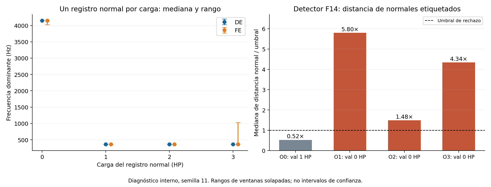
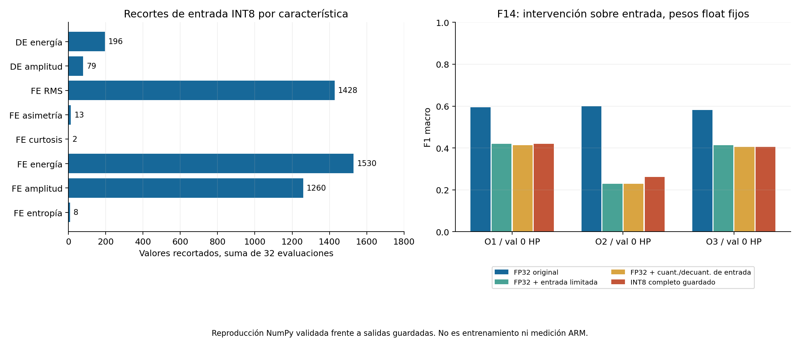

# Diagnóstico de los representantes V2

## Dictamen

No se encontró un error de orden de características, IDs, escalado o cuantización.
La entrada INT8 y los scores del detector se reprodujeron exactamente en los32.
El diagnóstico distingue dos limitaciones: transferencia de la representación normal
entre registros/cargas y pérdida de información por el rango de entrada INT8.
No se entrenó, reconvirtió, cambió un parámetro o calculó una predicción externa.

Sí se realizaron reproducciones numéricas: 22032 filas-forward NumPy con pesos
guardados y score de normalidad con parámetros guardados. No se invocó TensorFlow
o TFLite. El forward original coincidió en todas las clases con las referencias
guardadas; error máximo de probabilidades 1.60932541e-06.
Eso respalda el diagnóstico, sin afirmar identidad bit a bit de kernels o probabilidades.

## 1. El registro normal de0HP tiene una representación distinta

| MAT / carga | Ventanas | RMS DE mediana | RMS FE mediana | Frecuencia dominante DE |
|---|---:|---:|---:|---:|
| 97 / 0HP | 28 | 0.071397 | 0.082097 | 4145.5078Hz |
| 98 / 1HP | 58 | 0.061294 | 0.069361 | 360.3516Hz |
| 99 / 2HP | 58 | 0.057077 | 0.065567 | 360.3516Hz |
| 100 / 3HP | 58 | 0.057672 | 0.074206 | 360.3516Hz |

En los tres F14 que validan0HP, las28normales se clasifican OR ya en FP32
y no tienen entradas recortadas. Su error no se origina en saturación de entrada.
La frecuencia dominante corresponde al mayor pico noDC; no es automáticamente la
frecuencia de giro. Que NF12 rinda mejor en estos representantes es un indicio
para evaluar esa representación ya predefinida, sin demostrar causalidad exclusiva
de la frecuencia: son redes entrenadas por separado y solo hay una semilla.

Solo existe un MAT normal por carga. No puede separarse un efecto general de carga
de una particularidad de ese registro, adquisición, montaje o ruido. La reconstrucción
desde MAT ya se auditó anteriormente; este diagnóstico no repitió extracción RAW.
No hay evidencia instrumental nueva para cambiar Fs, etiquetar MAT97 como falla o eliminarlo.

## 2. El recorte de entrada explica buena parte de la degradación INT8 en F14

De4516valores recortados,4218(93.40%) son FE RMS, energía y amplitud.
Las frecuencias dominantes4/11 no se recortan. Se contabilizan valores de
características en evaluaciones repetidas, no4516ventanas físicas diferentes.
En F14 hay120cambios FP32–INT8 al validar0HP;119ocurren en ventanas con recorte.
Globalmente35de486cambios ocurren sin recorte: también intervienen redondeo,
cuantización de pesos/activaciones y decisiones cercanas a las fronteras.

Con los mismos pesos float se comparan entradas originales, entradas limitadas
al rango representable y entradas cuantizadas/decuantizadas. Son intervenciones
diagnósticas, no modelos candidatos nuevos. El límite continuo y el recorte
después de redondear difieren alrededor de medio paso de cuantización.

| F14 outer | Float original | Solo límite de entrada | Cuant./decuant. entrada | INT8 guardado |
|---|---:|---:|---:|---:|
| 1 | 0.594162 | 0.419492 | 0.412698 | 0.419492 |
| 2 | 0.598474 | 0.229372 | 0.229372 | 0.261758 |
| 3 | 0.580998 | 0.412698 | 0.405774 | 0.405774 |

Limitar la entrada basta para reproducir la caída en gran parte de estos casos.
No se atribuye el residuo entre entrada cuant./decuant. con pesos float e INT8
exclusivamente a pesos: también incluye activaciones internas y aritmética.
NF12 tiene los mismos recortes que F14 en estos scopes y distinta sensibilidad;
por ello recorte presente no implica idéntica degradación para cualquier red.

## 3. El detector aprende una normalidad demasiado estrecha para estos registros

| F14 outer / validación | Umbral | Mediana distancia normal / umbral | Normales aceptadas |
|---|---:|---:|---:|
| 0 / 1HP | 711.030 | 0.525 | 58/58 |
| 1 / 0HP | 711.030 | 5.802 | 0/28 |
| 2 / 0HP | 986.174 | 1.485 | 3/28 |
| 3 / 0HP | 337.697 | 4.335 | 0/28 |

RMS, energía y amplitud de DE/FE aportan92.95–96.38% de la distancia media
de normales0HP para F14. Las frecuencias ya están excluidas del detector:
F14 y NF12 comparten exactamente sus parámetros. No basta quitarlas de la DNN
para corregir el rechazo del detector.
El scaler normal-only estima variación de un solo MAT; las diferencias entre
registros pueden equivaler a muchas desviaciones de esa normalidad estrecha.
La calibración acepta56/58normales de su propio MAT, sin garantizar cobertura
de otra carga. Outer2/3 comparten ajuste y scores normales0HP, pero otro registro
de calibración cambia el umbral986.174→337.697. No se alteró ninguno.

## 4. Consecuencias para el plan y el artículo

Aumentar solo50→100épocas no aborda los26ajustes ya detenidos por paciencia.
Los resultados respaldan separar el estudio de convergencia de los problemas
de representación, cuantización y normalidad. La pérdida total incluye L2:
el JSON separa CE y penalización en el mejor checkpoint, sin inventar la
descomposición de una curva que no se guardó por término.

El detector actual mide distancia respecto al dominio normal observado. Los
rechazos de normales impiden presentarlo como confirmación fiable de falla
entre todas estas condiciones. Esto es una limitación experimental sustentada,
no una razón para relabelar normales o aumentar el umbral con validación.

La próxima decisión debe documentarse como suplemento de desarrollo antes
de nuevas ejecuciones: mantener la referencia original, evaluar la robustez
de las máscaras predefinidas con las semillas/cargas completas y, si se añade
una variante de compresión de amplitud, fijar fórmula/índices y train-only antes.
No se elige NF12 automáticamente con estos32, no se recalibra INT8 con validación
ni se usa N0 para corregir retrospectivamente su propio umbral.
Para el detector, ninguna variante puede prometer resolver la falta de registros
normales independientes; debe evaluarse especificidad por MAT/carga y reportar
los fallos, incluso si ello limita su papel a rechazo de dominio.
Los32se conservan como referencia y representantes técnicos. Si se enmienda
el procedimiento principal, los nuevos representantes deberán provenir de la
misma versión seleccionada: no mezclar métricas o costos de modelos distintos.
El costo total STM32 sigue pendiente y no se modifica el manuscrito en esta etapa.

## Fuentes y límites

- [LiteRT: cuantización entera](https://developers.google.com/edge/litert/conversion/tensorflow/quantization/post_training_integer_quant): el conjunto representativo estima rangos; se cuantizan pesos y activaciones.
- [StandardScaler](https://scikit-learn.org/stable/modules/generated/sklearn.preprocessing.StandardScaler.html): estadísticos de entrenamiento reutilizados y sensibilidad a valores extremos.
- [CWRU: adquisición](https://engineering.case.edu/bearingdatacenter/apparatus-and-procedures): posiciones DE/FE y configuraciones de muestreo documentadas.
- Evidencia local: `DIAGNOSTICO.json`, cinco CSV, cierre32 y auditoríaCWRU previa. Todos los datos son retrospectivos y ya explorados.
No se calculan p-valores o intervalos IID a partir de ventanas solapadas.
Los gráficos son recursos diagnósticos exportables; todavía no se insertan en el artículo.
